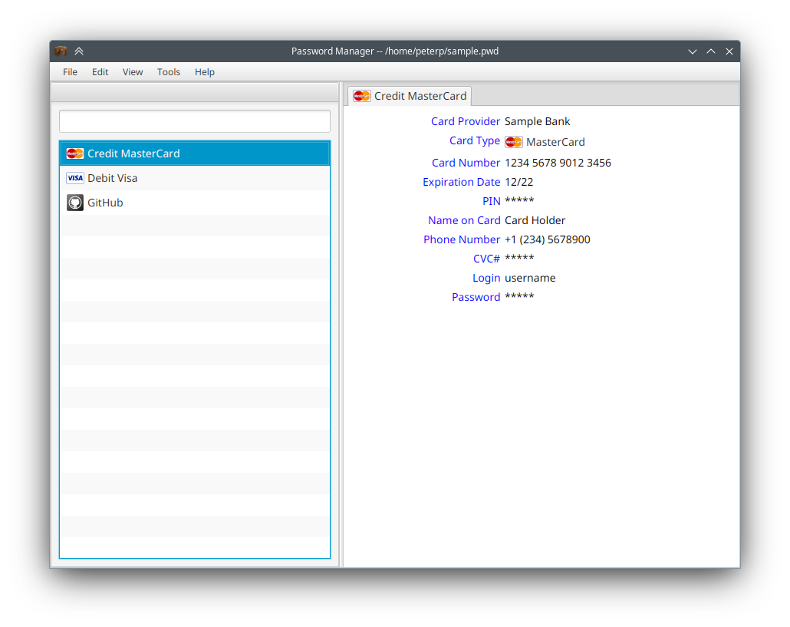
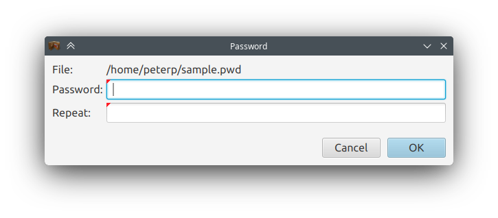
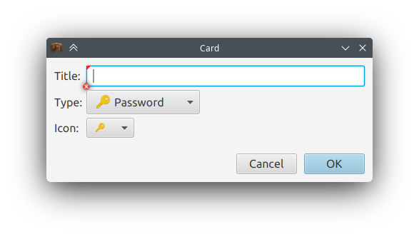
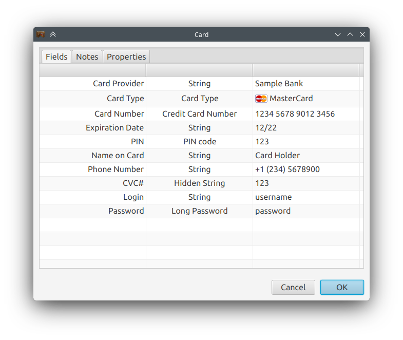
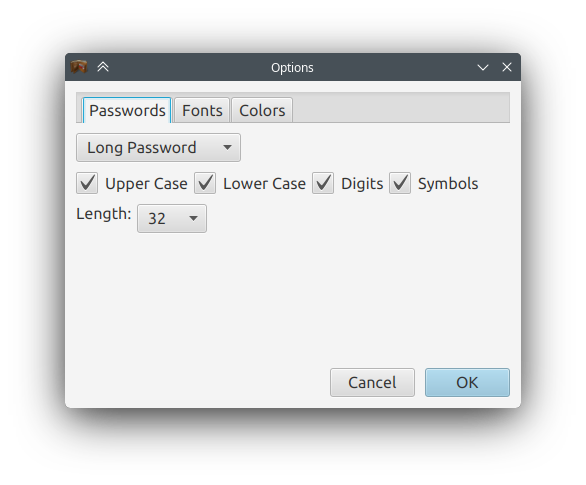
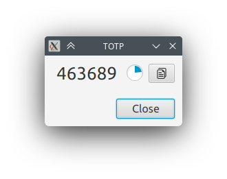

# Password Manager

Desktop application to store passwords, credit card numbers and other sensitive information.
The application uses 256-bit AES encryption.

## Security Considerations

The application enforces security via file encryption only. It makes no effort to defend against attacks targeted
at a user's account, operating system, or hardware, including RAM.

## Files

To create a new password manager file select menu item _File → New_. After selecting a file name and location, 
a password dialog will open. Password is used as an encryption key and is not stored anywhere. Password can be set 
empty, in this case file will not be encrypted and stored as plain XML.

To open an existing file select menu item _File → Open_ (`Ctrl-O`).

Password Manager remembers last opened file.

There is no separate action for saving. File is saved in place after any action that changes its content.

To change password for an opened file select menu item _Tools → Change Password..._.

## Cards and Notes

The application supports two types of items: card and note.

Cards can be created via menu item _Edit → New Card..._ (`Ctrl-N`). Cards have fields, icon and additional note text.
There are several predefined types of cards that define initial set of fields.

Notes can be created via menu item _Edit → New Note..._ (`Ctrl-T`). Notes are used to store plain text of arbitrary
length.

An item can be made a favorite. Such items are marked with star and shown on top of the list.

To edit an item select it in the list and select menu item _Edit → Edit..._ (`Ctrl-E`).

To delete an item select menu item _Edit → Delete_ (`Shift-Delete`). Items are not removed from the file immediately. 
To toggle deleted items visibility select menu item _View → Show Deleted_. Deleted items are marked with trash can icon 
and can be purged using menu item _Edit → Finally Delete_ (`Shift-Delete`) or restored using menu item _Edit → Restore_.

To purge all deleted items select menu item _Tools → Purge_.

## Card Field Types

The following field types are supported:

| Type               | Hidden | Special action                 |
|--------------------|--------|--------------------------------|
| String             |        |                                |
| Hidden String      | ✓     |                                |
| Email              |        | Open email client              |
| Credit Card Number |        | When copied spaces are removed |
| Credit Card Type   |        |                                |
| Link               |        | Open in browser                |
| Pin                | ✓     | Generate PIN                   |
| UNIX Password      | ✓     | Generate password              |
| Short Password     | ✓     | Generate password              |
| Long Password      | ✓     | Generate password              |
| Date               |        |                                |
| Expiration Month   |        |                                |
| TOTP Recovery Code | ✓     | Show generated TOTP            |

Hidden values are not shown when selecting the card. To toggle visibility double click on value.

### Link and Email

Links and email addresses are shown as hyperlink string. When clicking on such value in viewer a system configured
default browser or email client will be opened.

Email addresses should be stored as is without `maito:`.

### Passwords

When editing card passwords can be generated in place using context menu item _Generate_ (`Ctrl-G`).

Password length and character sets are configured for each type via menu item _Tools -> Options_ (`Ctrl-Alt-S`):

### TOTP Recovery Code

For these fields TOTP generator can be opened and used to enter code on web sites.

Obviously this defeats the purpose of 2-step verification using separate device. However, in case there is an issue
with such device this option can be used as an emergency.

## Binary Distributions

There are intentionally no binary distributions. The sole purpose of this project is to have a trusted application
built from source.

If you prefer pre-made binaries there are many much more feature rich applications out there.